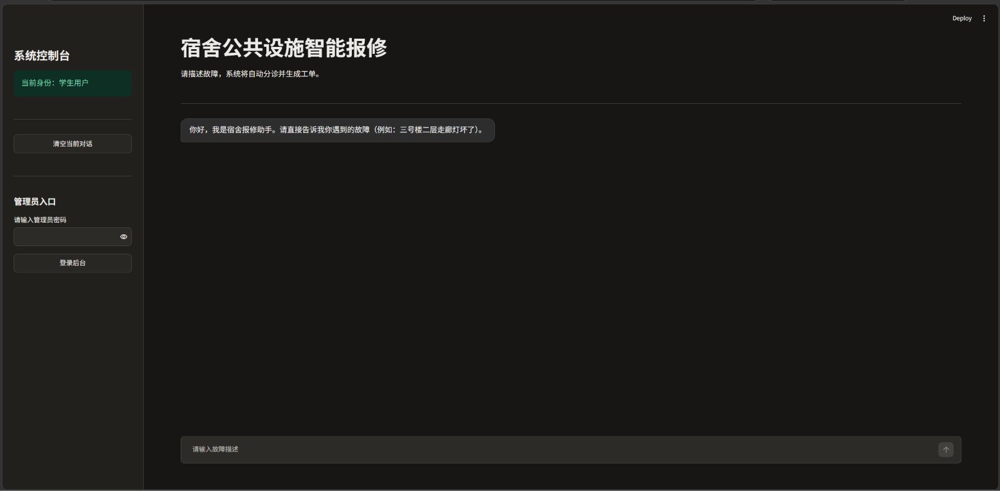
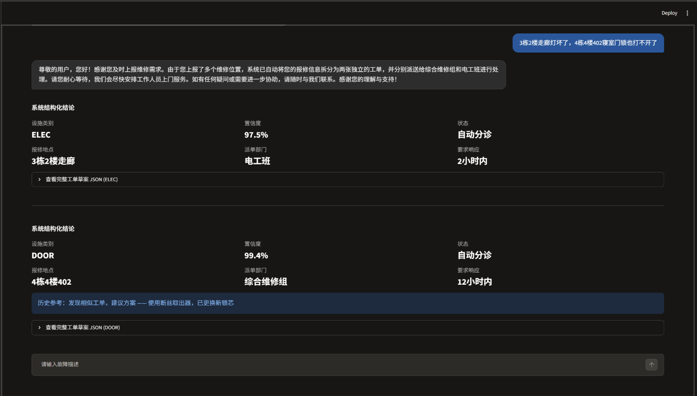
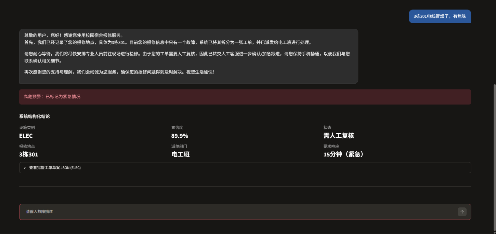

# 宿舍楼公共设施报修文本分诊与低置信复核 Agent

> 《机器学习》课程期末项目 · 个人项目 · 028123179 唐辉

一个面向高校宿舍报修场景的智能分诊系统：学生用一句口语描述故障，系统自动判断设施类别、抽取报修位置、识别高危情况、生成结构化工单并派单；信息不足时主动多轮追问，置信度过低时转人工复核。

核心分类能力由 **TF-IDF（字符级 1–3 元）+ 逻辑回归** 提供，大语言模型只负责把结构化结果转写成客服口吻的播报，不参与分类决策——以保证结果可评估、可复现。



---

## 主要功能

| 功能 | 说明 |
|---|---|
| 文本分诊 | 7 类设施（ELEC/WATER/HVAC/FURN/DOOR/APPL/STRUCT），输出类别与置信度 |
| 位置抽取与校验 | 正则抽取楼栋/楼层/房间号/公区；室内设备强制房间号，公区只需楼层 |
| 多轮追问 | 信息不足时不硬分类，保留上下文继续追问，补齐后出单 |
| 多故障拆单 | 一句话含多个位置与故障时自动拆成多张工单；位置不全的先出单、后补全 |
| 高危兜底 | 关键词规则独立于模型，命中即强制人工复核并把响应时限压到 15 分钟 |
| 低置信复核 | 置信度 < 0.6 且 top1–top2 差值 ≤ 0.3 时转人工，后台可修改类别并下发 |
| 历史检索 | TF-IDF 余弦相似度检索相似历史工单，附上处理方案供参考 |
| 工单持久化 | SQLite 存储，管理员端可查看待复核与全部历史工单 |

---

## 快速开始

```bash
# 1. 安装依赖（建议 Python 3.10+，本项目在 3.12.10 上验证）
pip install -r requirements.txt

# 2. 配置大模型密钥（可选，不配置时播报走兜底文案，分类功能不受影响）
#    在项目根目录新建 .env，内容：
#    ZHIPU_API_KEY=你的智谱APIKey

# 3. 生成数据集（固定 seed=42，约 2934 条）
python make_csv.py

# 4. 训练模型并输出指标
python src/train.py

# 5. 启动网页
streamlit run app.py
```

浏览器访问 `http://localhost:8501`。左侧边栏可登录管理员端（默认密码 `admin123`）。

> 仓库已附带训练好的 `models/*.pkl`，跳过第 3、4 步也能直接启动。

## 演示视频

[▶ 观看约 65 秒的演示录屏](docs/demo.mp4)（1.1 MB）

演示内容：本地启动服务 → 输入"你好，3栋3楼303宿舍灯坏了" → 输出类别、置信度、报修地点、派单部门与要求响应时间 → 展开完整工单 JSON。

> GitHub 不支持在 README 里内嵌播放 MP4，点击链接会在文件页打开播放器。

---

## 目录结构

```
dorm-facility-triage-agent/
├── app.py                     # Streamlit 界面（学生端 + 管理员端）
├── database.py                # SQLite 工单表与读写
├── make_csv.py                # 数据集生成（模板 / 错别字 / 混合故障）
├── requirements.txt
├── .env                       # ZHIPU_API_KEY（已在 .gitignore 中排除）
├── data/
│   ├── annotations.csv        # 2934 条标注数据
│   ├── history_tickets.csv    # 历史工单（RAG 用）
│   └── tickets.db             # 运行时工单库（不入库）
├── models/
│   ├── lr_model.pkl
│   └── vectorizer.pkl
├── src/
│   ├── agent_router.py        # 分诊主逻辑（清洗 / 抽取 / 拆单 / 规则 / 播报）
│   └── train.py               # 训练与评估
├── experiments/
│   ├── run_test_cases.py      # 7 个端到端验收用例
│   ├── ablation_cleaning.py   # 训练端清洗消融
│   ├── diagnostics/           # 混淆矩阵、规则查全率、验证集选型
│   └── test_cases_report.md   # 测试记录表
└── docs/screenshots/          # 界面与用例截图
```

---

## 模型与实验结果

**数据**：2934 条 = 训练 2051 / 验证 439 / 测试 444；真实素材 23 条 + 模板合成 2911 条；高危样本 396 条（13.5%）。

**主结果（测试集 444 条，不参与调参）**

| 配置 | Macro F1 | Accuracy |
|---|---|---|
| 朴素贝叶斯 · 训练端不清洗 | 0.9133 | — |
| 朴素贝叶斯 · 训练端清洗 | 0.9378 | 0.9369 |
| 逻辑回归 · 训练端不清洗 | 0.9755 | — |
| **逻辑回归 · 训练端清洗（主模型）** | **0.9935** | **0.9932** |

**消融结论**：训练与推理必须使用同一套清洗流程。只在推理端清洗时 F1 为 0.9755，两端一致后提升到 0.9935。

**验证集选型**（439 条，只用于选特征与超参）

| 配置 | 特征维度 | Macro F1 |
|---|---|---|
| 词级 1–2gram，C=1 | 1810 | 0.9842 |
| 字符级 1–3gram，C=1 | 4829 | 0.9798 |
| 字符级 1–3gram，C=10 | 4829 | 0.9911 |

> 注意：0.9935 受合成数据模板相似度影响（20% 的测试样本在训练集中有 ≥0.8 的近邻），不代表真实口语场景的预期水平。

---

## 验收测试

7 个端到端用例（标准报修、多轮追问、拆单、高危、意图打断、低置信、垃圾输入），全部通过。

| 编号 | 输入 | 结果 |
|---|---|---|
| TC-01 | 你好！ 5栋三楼305宿舍灯坏了！麻烦快点 | ELEC 98.8%，5栋三楼305，电工班，自动分诊 |
| TC-02 | 空调不制冷 → 在3栋2楼 → 201 | 两轮追问后 HVAC 99.9%，3栋2楼201 |
| TC-03 | 3栋2楼走廊灯坏了，4栋4楼402寝室门锁也打不开了 | 拆 2 单：ELEC 97.5% / DOOR 99.4% |
| TC-04 | 3栋301电线冒烟了，有焦味 | 高危，需人工复核，15 分钟紧急 |
| TC-05 | 马桶堵了 → 哎，今天上课太累了 → 1栋2楼走廊厕所 | WATER 94.0%，闲聊未污染状态 |
| TC-06 | 那个东西有点问题，一直响 → 2栋2楼201 | ELEC 37.0%，转人工复核 |
| TC-07 | 你好，给我讲个笑话 / ????? | 不生成工单，引导回正题 |

复现：

```bash
python experiments/run_test_cases.py
```

| | |
|---|---|
|  |  |

---

## 复用组件

| 组件 | 版本 | 许可证 | 用途 |
|---|---|---|---|
| scikit-learn | 1.9.1 | BSD-3-Clause | TF-IDF、逻辑回归、朴素贝叶斯、评估 |
| jieba | 0.42.1 | MIT | 历史工单检索分词 |
| pandas | 3.1.1 | BSD-3-Clause | 数据处理与分层划分 |
| Streamlit | 1.67.0 | Apache-2.0 | 网页界面 |
| zhipuai | 2.1.5.20250825 | 官方 SDK | 调用 GLM-4-Flash 生成播报 |
| python-dotenv | 1.2.4 | BSD-3-Clause | 读取本地密钥 |

完整清单、来源链接与自研部分说明见 [`THIRD_PARTY_LICENSES.md`](THIRD_PARTY_LICENSES.md)。

---

## 数据与隐私

- 数据集中不含姓名、学号、真实房号；位置统一抽象为"某宿舍/某栋某层走廊"。
- `ZHIPU_API_KEY` 仅保存在本地 `.env`，`.gitignore` 已排除，未写入任何源码或截图。
- 若需部署到 Streamlit Cloud，在 App 的 Secrets 中配置 `ZHIPU_API_KEY = "..."`。

---

## 已知局限

1. 合成数据模板相似度高，测试分数偏高，真实场景预期会下降；
2. 单标签模型无法表达一句多故障，依赖 Agent 层按标点拆单；
3. 多轮状态基于正则与关键词，复杂意图切换仍可能误判；
4. 高危规则查全率约 60.6%，覆盖面受词表限制；
5. 置信度未经校准（C=10 下概率偏自信）。

---

## 声明

本项目为个人课程作业，代码与实验由本人完成；开发过程使用了生成式 AI 辅助调试与文字润色，详见报告附录 A。
